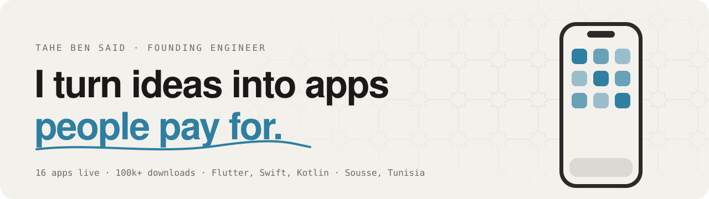
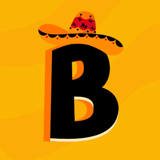

<a href="https://tahebensaid.dev">
  <picture>
    <source media="(prefers-color-scheme: dark)" srcset="assets/banner-dark.svg">
    
  </picture>
</a>

  <a href="https://tahebensaid.dev"><b>Portfolio</b></a> ·
  <a href="https://tahebensaid.dev/Tahe_Ben_Said_CV_EN.pdf">CV (EN)</a> ·
  <a href="https://tahebensaid.dev/Tahe_Ben_Said_CV_FR.pdf">CV (FR)</a> ·
  <a href="https://www.linkedin.com/in/tahebensaid/">LinkedIn</a> ·
  <a href="mailto:tahe.bensaid.pro@gmail.com">tahe.bensaid.pro@gmail.com</a>

Give me the problem and I'll hand you the product: the scope, the architecture, the apps, the payments and the release. Five years of Flutter, Swift and Kotlin, sixteen apps live in the stores.

### Shipped

<table>
  <tr>
    <td align="center" width="16%"><a href="https://apps.apple.com/tn/app/%D8%B4%D8%A7%D8%B7%D8%B1-chaatr/id6798395603"> <b>Chaatr</b></a> founding engineer</td>
    <td align="center" width="16%"><a href="https://theproperhumandiet.net"> <b>Proper Human Diet</b></a> lead Flutter</td>
    <td align="center" width="16%"><a href="https://play.google.com/store/apps/details?id=com.softylines.takiacademy"> <b>Takiacademy</b></a> 100k+ downloads</td>
    <td align="center" width="16%"><a href="https://play.google.com/store/apps/details?id=com.yallagodelivery.app"> <b>YallaGo</b></a> customer app</td>
    <td align="center" width="16%"><a href="https://play.google.com/store/apps/details?id=com.yallago.rider"> <b>YallaGo Rider</b></a> courier app</td>
    <td align="center" width="16%"><a href="https://play.google.com/store/apps/details?id=com.yallago.resto"> <b>YallaGo Resto</b></a> restaurant app</td>
  </tr>
  <tr>
    <td align="center"><a href="https://play.google.com/store/apps/details?id=com.takiacademy.takiacademykids"> <b>Takikids</b></a> 4.7 rating</td>
    <td align="center"><a href="https://play.google.com/store/apps/details?id=com.linkefoot.linkefootApp"> <b>LinkeFoot</b></a> football social</td>
    <td align="center"><a href="https://play.google.com/store/apps/details?id=com.softylines.chichkhan"> <b>Chichkhan</b></a> ordering</td>
    <td align="center"><a href="https://play.google.com/store/apps/details?id=com.digicoser.boritos"> <b>Boritos</b></a> ordering</td>
    <td align="center"><a href="https://play.google.com/store/apps/details?id=com.softylines.studenthelp"> <b>وتعاونوا</b></a> student help</td>
    <td align="center"><a href="https://pub.dev/packages/bmdrm_mobile"><b>BMDRM SDK</b></a> video DRM for Flutter, iOS and Android</td>
  </tr>
</table>

### Right now

- **Chaatr**, founding engineer. Took it from an idea to three live apps for students, parents and teachers, with an AI companion and real payments.
- **The Proper Human Diet**, lead Flutter developer. One codebase for iOS, Android and the web.
- **Freelance product engineering.** Built YallaGo's whole stack alone: three apps and a web portal.

### Free tools

| Ship it safe | Make it feel right | Review like a lead |
| --- | --- | --- |
| [flutter-release-check](https://github.com/TaheBenSaid/flutter-release-check) | [flutter-rtl-audit](https://github.com/TaheBenSaid/flutter-rtl-audit) | [pr-self-check](https://github.com/TaheBenSaid/pr-self-check) |
| [flutter-secure-session](https://github.com/TaheBenSaid/flutter-secure-session) | [flutter-ux-details](https://github.com/TaheBenSaid/flutter-ux-details) | [kind-code-review](https://github.com/TaheBenSaid/kind-code-review) |
| [mobile-sensitive-screen](https://github.com/TaheBenSaid/mobile-sensitive-screen) | [flutter-feature-scaffold](https://github.com/TaheBenSaid/flutter-feature-scaffold) | |
| [mobile-payments-checklist](https://github.com/TaheBenSaid/mobile-payments-checklist) | | |

### Stack

BLoC and Clean Architecture, payments and subscriptions, real-time apps, RTL and Arabic, CI and store releases.

Based in Sousse, Tunisia (UTC+1). English, French, Arabic, some German. Open to founding and lead roles.
